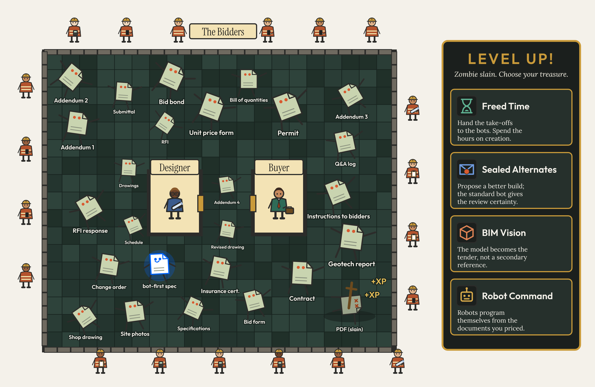

# The zombie garden

<!--
Part I. The way in. Chapter 4 since 2026-11-07: moved from the introduction to close Part I, the last of the four chapters in vgr_zirp's suggested reading order for a newcomer (session 2, answer 5), where the garden reads "as diagnosis rather than decoration" after the proof, the delivery methods and the failure modes. The file name keeps its old number. Its opening (Sewell) and its last line ("this book lays out the danger, the treasure, and the campaign") still read as an introduction; to rework in the openers pass.
vgr_zirp pass (Andre, 2026-11-07, on session 2, answer 1: make the stakeholders principals in the first third, and show the treasure before the danger): Claude's sentence after the walled garden, to confirm, "Only the people who live alongside them, the buyers, consultants, bidders and courts, can decide to."; and the two treasure paragraphs now come before the danger paragraph, with "the danger, the treasure, and the campaign" reordered to match.
Openers pass (2026-11-07): "this book lays out the danger, the treasure, and the campaign" now says "this chapter". The Sewell opening stays as Andre chose it; the vgr_zirp review (session 2, answer 1) found it academic for buyers, bidders and lawyers, so one alternative is offered in the PR, not applied: open on the PDF and bring Sewell in second ("Nobody would choose the PDF as the contracting tool of a digital industry today. It rules because of the order in which things happened, not because of what it does. William Sewell, in "Three Temporalities", calls this eventful temporality..."), Claude's wording.
Until 2026-11-07: front matter, after the prologue. Andre's draft of 2026-11-04 (heading "PDF"), edited with Claude on 2026-11-04 and 05 over four versions; the drafts are in the project files under chapter-drafts/ (introduction-pdf-zombie*). Andre placed it as a separate introduction, the book's problem statement, after the prologue (2026-11-05). Word count about 1,130.
Andre's calls: Sewell kept over QWERTY because the PDF is the topic; the revolt is June 1848; "the machine is the easy part" (the first build has taken almost two months); villagers = the stakeholders in construction procurement, adventurers = tech entrepreneurs looking to disrupt the system (Ibn Khaldun's nomads dropped); "community building" rather than "field building", which clashes with the metaphors; "approve" kept for every stakeholder, since strong disagreement from any of them would kill the idea; names (Lamport, Rao, the Protocol Institute, Sathe) left out of the liveness paragraph because the likely readers know the concepts; the golem dropped as too hard this early; zombies plural to match the figure.
Claude's sentences, to confirm in Andre's voice: the undead-protocol paragraph; "Every drawing, specification and addendum is a zombie"; "a walled garden"; the wasted-bids lines ("Meanwhile, the waste goes on…" to "…pay for it in the end"); the three examples of tedious work; "The practical treasure begins with"; "On a standardized, digital-first stack… from the same documents the bidders priced"; "That specification would be the first living document in the garden"; "Under that fear sits the question this book keeps returning to"; the adventurers' lines and "A garden cleared that way soon fills up again"; "The standards are the strange new rules".
Sources (Appendix D): Sewell, "Three Temporalities" (1996), whose June 1848 example draws on Traugott, Armies of the Poor (1985), from memory and to check against the essay (Traugott dropped from Appendix D, Andre, 2026-11-05); safety and liveness after Lamport (1977), with the wider sense of liveness from Venkatesh Rao and the Protocol Institute and Aneesh Sathe's thickets ("The Birth of Thickets", 2026, now in Appendix D); paper sizes from DIN 476 (1922) and ISO 216 (1975). The release of human capital from "the cognitive serfdom of documentation and administration" is informed by Venkatesh Rao, "Cognitive Mercantilism" (Contraptions, 25 October 2026; Andre, 2026-11-05): AI could free minds from producing intelligence just to get by, as the agricultural revolution freed most people from farming. Rao applies "cognitive serfs" to AI kept merely obedient, so the book's use (people serving the paperwork) is a turn on his word, not a quote.
Cross-references: sealed alternates are the treasure here and the Serpent's hunting ground in chapter 3; "slow the velocity and raise the margins" echoes chapter 2's gold digger and coaster; the ending's thickets answer chapter 3's line that a world without monsters loses its liveness.
Figure: images/zombie-garden.png, theme "moonlit". The "ink" theme of the same script is kept in reserve for a black-and-white print interior.
Proposed, not decided (Andre, 2026-11-04): this piece could replace chapter 1, "Starting a relationship expecting a divorce", with that chapter's material moving to chapters 2, 3 and 6 (numbers of the time). Since the 2026-11-07 reorder the divorce chapter is chapter 5 and this piece is chapter 4.
-->

William Sewell, in "Three Temporalities", writes some good prose about the Paris workers' revolt of June 1848 in support of his eventful temporality: the idea that the mechanisms of social life are best understood through the order of events.

If we wanted to add a mundane example, the persistence of PDF documentation surely provides the strongest support for his system. Its dominance as the digital contracting tool is only a relic of the events of the past. No one would argue that a teleological or an experimental temporality would better explain it.

The standardization of paper sizes in the 20th century allowed for the commoditization of communications. The printers, copiers, and fax machines could all interact to produce an analog final version of a digital product, and the PDF carried that paper sheet into the digital age. Times have changed, and the tool has become a horde of monsters. Every drawing, specification and addendum is a zombie shambling on your phone, needing constant zooming and focusing to read, colonizing your computer screen with unnecessary margins, and attacking human and AI liveness with its inability to be modified.

The PDF is an undead protocol. As a technology it died with the fax machine, but as a protocol it kept walking, because the paper set it imitates carries the engineer's seal and the contract's signatures. The file inherited the paper's place in the law: the copy that is stamped, issued and frozen, the one a court reads when a dispute arrives. A protocol owes its users two things: safety, the promise that nothing bad will happen, and liveness, the promise that something good eventually will, so that the system keeps growing and changing. The PDF has safety in abundance and no liveness at all. That is what makes it undead.

Construction procurement has built a walled garden around these zombies to control their damage, but refuses to kill them. Only the people who live alongside them, the buyers, consultants, bidders and courts, can decide to.

The garden may be slow and inefficient, but it moves the information between buyers and bidders in a reliable fashion. The courts have resolved most of the issues, so why go into the courtyard of the undead when there are entire worlds to explore and conquer?

There may be no glory in the work, but it has to be done, and if the bots are going to take it on, they will need strange new rules to do it.

Since wandering among the undead involves risk, this chapter lays out the treasure, the danger, and the campaign.

The treasure is improved productivity in construction, lowering costs and expanding the options. The greatest part of it is the release of human capital from the cognitive serfdom of documentation and administration: the take-offs counted by hand, the quantities retyped from one document into another, the hunt through three addenda for the one that changed a detail. Freed from it, people can turn to exploration, creation, and community building.

The practical treasure begins with sealed alternates. Standardized documents read by a standard bot would bring certainty to the review of a bidder's alternate, and that certainty would unleash the untapped capacity of the bidders to improve the product, with the benefits shared with the buyers. Then there is the industry's transition to digital tools. BIM modelling has existed for long enough that its lack of uptake should be considered structural, and standards for bots could grow to encompass it as well. Finally, programming construction robots currently requires translating data between formats. The checks on each translation ensure a high degree of accuracy, but better base documentation could remove the translation altogether and accelerate adoption. On a standardized, digital-first stack, the robots could program themselves from the same documents the bidders priced, and automated bidding could carry a project from conception to completion.

The danger is anachronistic technology crushing innovation, as maintaining the system becomes a rent-seeking enterprise. The impulse to innovate becomes buried under the desire to slow the velocity and raise the margins. Meanwhile, the waste goes on in plain sight. Every bidder reads the same drawings, takes off the same quantities and prices the same work, and on a job with six bidders, five of them do it for nothing. Their effort does not vanish: it comes back as overhead in the next bid, and the buyers pay for it in the end.

The operational plan? To prepare an expedition to the heart of the procurement process, the documentation of requirements, to slay the PDF zombies and free the villagers from their evil reign.

As bad as the zombies may be, they are providing an essential service. All the villagers have structured their lives around their existence, so their death would also collapse the system.

To kill the PDF, we will need a revised documentation system, built bot-first: specifications that cannot be misread by machines, and that adjust to the display, whether a phone, a computer or a robot's instructions. That specification would be the first living document in the garden. The technology already exists, but reasonable fears of liability will keep designers from adopting it unless standards can be used to determine the appropriate techniques and standards of care. Under that fear sits the question this book keeps returning to: when a bot causes harm, who pays?

Once dead, the PDF will need to stay dead, and the documentation standards only start the process. A standard bot will be needed to validate the documentation for AI consumption, so that designers can verify that AI is correctly interpreting their documents. When the designers sign off on its outputs, a baseline is established, and custom bots can be supplied to the market to meet the bidding strategies of the different bidders.

The advent of AI creates both the demand and the means for these tools, and the machine itself is the easy part. Throw enough magic tokens at the problem, and a suitable program will be conjured into existence. There is work to do, but it takes place at the workbench.

The real challenge will come from the community building. Adventurers have passed through the village before: tech entrepreneurs who ride in to disrupt the system, slay a monster, carry off whatever treasure they can find and ride on. A garden cleared that way soon fills up again. What lasts is the work of the villagers, the stakeholders in construction procurement: buyers, consultants, bidders, the legal system, politicians, researchers, and the standards agency. The standards are the strange new rules, and only the villagers can approve them. The campaign ends with them moving into the town square they build together over the old zombie garden.

The settlement of the new domain will de-wild the current graveyard. It will also create new spaces for thickets to form, places where wildness flows from human imagination, bringing new liveness into the world.
