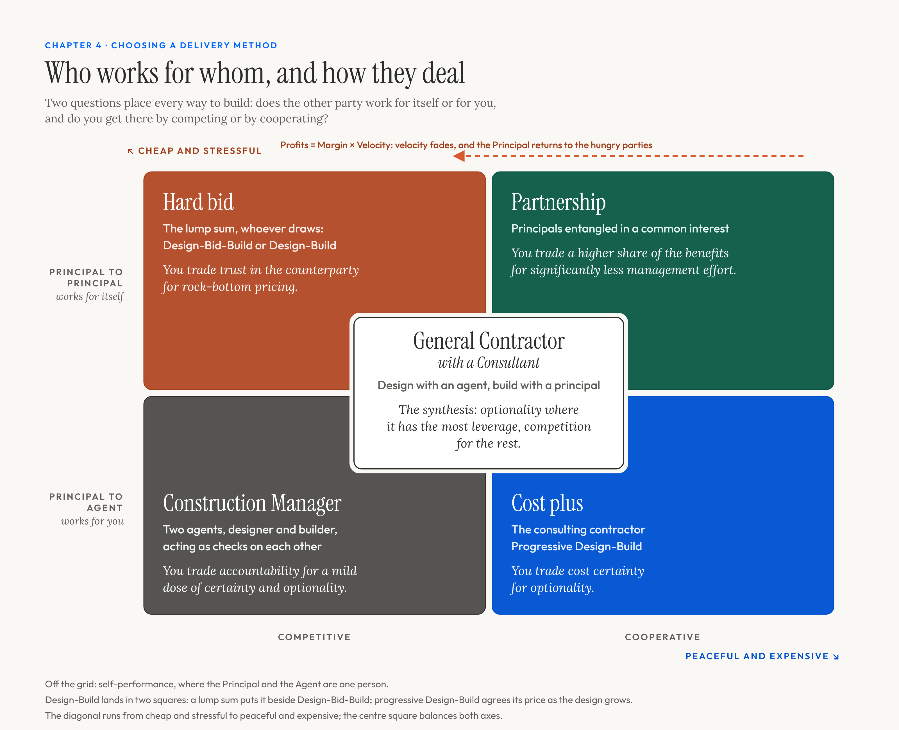

# How a price is judged today

Since the niche world of construction procurement should put most of us to sleep, we can spice things up with the buzz topic of the Principal/Agent problem.

So, you want to build a house. Let's look at your options.

*Who works for whom, and how they deal. Cheap and stressful in one corner, peaceful and expensive in the other; the General Contractor with a Consultant balances both axes.*

## Self-performance: off the grid

Well done, you have selected the path of self-sufficiency and knowing yourself. If you succeed, new skills are unlocked. If you fail, you gain knowledge of your limitations.

For beginners, this works well for that drywall patch. For experts, an entire home may be possible. For masters, small villages could be produced.

All great; all lacking in scale, limited both by one person's ability to project a vision into the world and by the lower productivity of the generalist.

To solve this, we start to muddy the Principal/Agent waters.

## Two questions

So, you need more help. We could go trade by trade, but the end story is the same: someone is willing to trade with you, so you arrive at a bargain.

Unlike a bargain for grain, clothes, or pleasurable company, this bargain is for goods that cannot be evaluated before entering into an agreement. For at least 3,776 years, humanity has struggled to resolve the issue.

The most common fix is to add a small dose of agentic responsibility to the one performing the work. Because they are the expert closer to the solution, this creates a small brake on the natural profit-maximizing tendencies that unmitigated transactions can bring about.

How much of a dose depends on two questions. Does the other party work for itself, a Principal like you, or for you, as your Agent? And do you deal with them by competing or by cooperating? The answers put every way to build in a corner of the map, with cheap and stressful at one end of the diagonal and peaceful and expensive at the other.

## Hard bid: Principal to Principal, competitive

Hand the whole job to one builder, design included, and you have Design-Build: the Babylonian problem. The builder has all the control. A lump sum controls the price, but requires some degree of adversarial relationship. Society can help set a floor against the worst-case scenarios, but friction is to be expected.

This works great when you know what you want, know how to ask for it, and know what it should cost.

You trade trust in the counterparty for rock-bottom pricing.

We don't all have the Type A energy to always inhabit that world, so we mortals go on tour for alternate solutions.

## Cost plus: Principal to Agent, cooperative

Maybe you want something more. You want to change your mind. You want to explore possibilities. You are willing to risk some capital, but don't want it all to go to the counterparty's margin.

A cost-plus contract moves you to the opposite corner of the map. The builder becomes a consulting contractor: it works for you, and you cooperate instead of competing. The scope and the price float. What keeps the contractor on your side is partly law and custom, but mostly the money: paid its costs plus a fee, it has little to gain by working against you. The catch: cost plus places all the risk on the Principal. Tactically useful, but expensive in the long run.

You trade cost certainty for optionality.

"Good options," you say, "but I have read too much Hegel. Give me a synthesis."

## General Contractor with a Consultant: the centre

To resolve the tension, a more complex protocol is brought into play: design with an agent, build with a principal.

The General Contractor model sits at the centre of the map because it visits two corners in turn. First comes the design, done by you or by a Consultant you hire. The Consultant works for you, so you keep your options open where they matter most. Once the drawings are done, often paid on a cost-plus basis, the work moves to the hard-bid corner, and General Contractors compete to build it. The legal system has built a ring around the sport, with heavy penalties for consultants who fail to act as agents, and rules for the fight between Principals.

## Construction Manager: Principal to Agent, competitive

The Construction Manager approach shows up when you want the hand-holding agents can provide through the whole job, but want a bit of extra insurance that they are on your side. The first agent acts as a consultant and prepares the design; the second works as an agentic general contractor to deliver the product. Both agents carry a responsibility towards the Principal and act as checks on each other.

Both agents work for you, which puts you in the bottom row. They keep each other honest, which puts you in the competitive column. The hard bidding still happens, but one level down, where the Construction Manager buys from the trades on your behalf. You gain loyalty and some cost control, and you pay for it in management effort to keep the job moving. There are now three parties to every decision, and it takes only one to slow progress.

You trade accountability for a mild dose of certainty and optionality.

"Great. This works, but I believe in the goodness of humanity and want a cooperative approach."

## Partnership: Principal to Principal, cooperative

Good news. There is a way. Partnerships entangle the Principals, giving them mutual benefits and an equitable distribution of the costs.

You trade a higher share of the benefits for significantly less management effort.

## Why does the hard bid survive?

Long-term relationships, controlled costs, shared benefits, reduced management effort: the peaceful corner sounds great. Let's just do that one over and over. What could go wrong?

Return = Margin × Velocity, as every business school teaches it.

If you have found true love, a partner with a masochistic bent or one enthralled by your motivational voodoo, you may have a golden goose on your hands. Most partners are not true love, and they have two ways to step off the treadmill: raise the margin or slow the velocity. The gold digger raises the margin, which pays, but usually spoils the magic for the Principal. The coaster is more insidious and lets velocity slip. Not all at once, but slowly, over time. It may not even be a reduction, just a lack of effort to keep up with the industry's baseline productivity growth. Peace gets more expensive every year.

For everyone but true love, the honeymoon ends.

Since the market sets the margin, the Principal must manage the velocity, and velocity lives in the cheap and stressful corner. That is the arrow across the top of the map: sooner or later, every partnership drifts back to the hard bid. Back to the hungry parties, the Principals looking to trade, who know someone else will take the work if they don't. Cheap and stressful wins again, not because anyone enjoys it, but because hunger is the one thing that never slows down.
