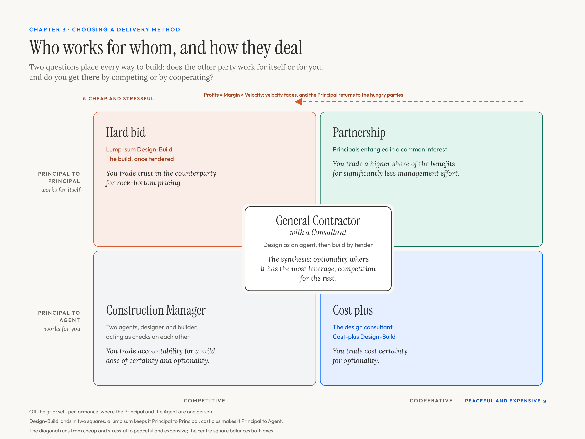

# How a price is judged today

<!--
Part I. The way in (chapter 2 since 2026-11-07, after the proof, following vgr_zirp's suggested reading order for a newcomer (session 2, answer 5); it was chapter 3)
Target: 1,200 words, mostly new
Recentred 2026-11-02 (Andre): the book's question is "When a bot causes harm, who pays?". This chapter holds the public buyer's narrower question, "Is this in the public interest?": a price can only be judged against the requirements it answers, and fair and reasonable is the legal test for the price part. Andre's early correction fits here: a price unfair "viewed independently" can still be best value (see the prologue's note on origins).
Brief: What "fair and reasonable" means to a public buyer, the engineer's estimate, the sold price books and the free bid tabulations, and the author's finding that a bot comes within about 20 percent of a human price line by line and must come within 2 to 3 percent before anyone trusts it alone.
Sources: positions 18, 22 and 23 (margins, return on capital, the bid cushion); `context-bank/what-buyers-pay.md`; `context-bank/bot-procurement-process.md`; `context-bank/contractor-margins.md` for one or two figures only.
Correction (2026-11-02, checked against `C:\hex_ai\estimator-workspace\RESULTS.md`): "within 20 percent" is slightly generous. Line by line on the locked test set, v0.3 misses the mean of the three lowest bids by a median 21.0% against the engineer's estimate's 28.6%; at the contract total by 13.0% against 14.4%. Say "about 20 percent" or "about a fifth". Useful for the chapter: the target itself is noisy, since the three lowest bidders differ from each other by a median 50% line by line, and one of them misses the other two by a median 25%. The engineer's estimate misses the three-lowest total by a median 11.2%.
Literature (`literature-review-2026-11-01.md`, Part 1): FHWA 2004 guidelines and 2015 review (engineer's estimates within 10 percent of the low bid on 48 percent of projects); USDOT OIG 2019; De Silva et al. 2008 (publishing the estimate lowered bids); UK Should Cost Model guidance; PSPC 2023 pricing guide; AACE 18R-97 and 98R-18; the $600-hammer story, now a sidebar at the end of the drafted sections (Andre, 2026-11-06: a strong narrative element, but the current build has no natural opening for it). Andre keeps the 2 to 3 percent target as a contractor's standard, not an engineer's (2026-11-01).
Added 2026-11-03 (Andre's draft, lightly edited by Claude): the opening sections below, from "Since the niche world" to "The dark exchange", are Andre's own prose on choosing a delivery method through the Principal/Agent problem. They are finished writing, not source passages; the price material follows on from their last line, the competitive exchange. References (Andre, 2026-11-03: no footnotes or endnotes; works go in Appendix D, the bibliography): the self-performance section draws on Red Green's *How to Do Everything* (Andre's copy is the paperback, 2026-11-05: Anchor Canada, 2011, ISBN 978-0-385-66775-3, confirmed by Andre; the earlier note said 2015); "3,776 years" counts from 1750 BC, the usual date for Hammurabi's code (1755 to 1750 BC); Rao's note is https://substack.com/@contraptions/note/c-374727395 (31 Oct 2026), which gives income as margin times velocity, so the formula reads "×" where the draft had "+". Changed 2026-11-03 (Andre): the line now reads "Return = Margin × Velocity, as every business school teaches it". The idea is the DuPont formula (return on investment = profit margin × asset turnover, F. Donaldson Brown, DuPont, about 1914 to 1920); the "velocity" wording is Ram Charan's, *What the CEO Wants You to Know* (2001), listed in Appendix D. Rao's note is what reminded Andre of it, and it opens the margin-and-velocity discussion (Andre, 2026-11-05: essential to the Principal/Agent discussion as its introduction to margin times velocity); listed in Appendix D. The note's argument: businesses usually raise margin rather than cut prices, because growing velocity takes more production, investment and customers. Principal/Agent frame (Andre, 2026-11-05): Noam Kolt, "Governing AI Agents" (Notre Dame Law Review, 2026), was essential to the discussion; it applies principal-agent economics and the law of agency to AI agents (literature review, Addendum 2); listed in Appendix D. The Design-Build sentence ending "through a lump-sum price while keeping the freedom to change their minds" finished a broken sentence in the first draft; on 2026-11-03 Andre replaced it with "Society can help set a floor against the worst-case scenarios, but friction is to be expected." Figure added 2026-11-03: `images/delivery-methods-2x2.png`, drawn with Andre (2x2 of Principal to Principal or Agent against competitive or cooperative, General Contractor with a Consultant in the centre, cheap and stressful to peaceful and expensive on the diagonal). Rewritten 2026-11-03 at Andre's request to follow the figure: self-performance off the grid, the two questions, hard bid, cost plus, the centre, Construction Manager, partnership, then velocity. Claude's sentences, to confirm: the paragraph opening "How much of a dose depends on two questions"; "Maybe you want something more"; the cost-plus paragraph the centre paragraph the Construction Manager paragraph and the closing section (all rewritten 2026-11-03 to lean on the map); the heading "Two questions". Restaged 2026-11-03 (Andre): Design-Build is the Babylonian problem, Principal to Principal, since the builder has all the control; cost plus shifts it to Principal/Agent but puts all the risk on the Principal; the General Contractor model (design-bid-build) is Principal to Agent for design plus Principal to Principal for the build, the synthesis. "Fiduciary" became "responsibility". The lump-sum trade line and the linking sentences between sections are Claude's, to confirm.
Openers pass (2026-11-07, after the vgr_zirp review, session 2, answer 2; Andre agreed the same day that self-deprecation comes out of the book): Andre's first line, "Since the niche world of construction procurement should put most of us to sleep, we can spice things up with the buzz topic of the Principal/Agent problem.", is cut, because it apologises for the reader's own profession. Its replacement, "Before a bot can judge a price, someone has to decide who works for whom. Economists call this the Principal/Agent problem, and in construction it has a map.", is Claude's, to confirm or rewrite. "So, you want to build a house" stays under review, not replacement (Andre, 2026-11-07). Options put beside it: (a) keep it; (b) "So, you want to build something. Alone, you will not get far: without relationships, very little gets built. Let's look at your options." (drafted in the vgr_zirp thread); (c) "So, you want to build a house, or a school, or a bridge. Let's look at your options." (Claude's; it answers vgr_zirp's point that a public buyer is not a private person building a house, while keeping the house for the self-performance ladder).
Paths are relative to construction-procurement-protocols unless they start with C:\.
-->

Before a bot can judge a price, someone has to decide who works for whom. Economists call this the Principal/Agent problem, and in construction it has a map.

So, you want to build a house. Let's look at your options.

*Who works for whom, and how they deal. Cheap and stressful in one corner, peaceful and expensive in the other; the General Contractor with a Consultant balances both axes.*

## Self-performance: off the grid

Well done, you have selected the path of self-sufficiency and knowing yourself. If you succeed, new skills are unlocked. If you fail, you gain knowledge of your limitations.

For beginners, this works well for that drywall patch. For experts, an entire home may be possible. For masters, small villages could be produced.

All great; all lacking in scale, limited both by one person's ability to project a vision into the world and by the lower productivity of the generalist.

To solve this, we start to muddy the Principal/Agent waters.

## Two questions

So, you need more help. We could go trade by trade, but the end story is the same: someone is willing to trade with you, so you arrive at a bargain.

Unlike a bargain for grain, clothes, or pleasurable company, this bargain is for goods that cannot be evaluated before entering into an agreement. For at least 3,776 years, humanity has struggled to resolve the issue.

The most common fix is to add a small dose of agentic responsibility to the one performing the work. Because they are the expert closer to the solution, this creates a small brake on the natural profit-maximizing tendencies that unmitigated transactions can bring about.

How much of a dose depends on two questions. Does the other party work for itself, a Principal like you, or for you, as your Agent? And do you deal with them by competing or by cooperating? The answers put every way to build in a corner of the map, with cheap and stressful at one end of the diagonal and peaceful and expensive at the other.

## Hard bid: Principal to Principal, competitive

Hand the whole job to one builder, design included, and you have Design-Build: the Babylonian problem. The builder has all the control. A lump sum controls the price, but requires some degree of adversarial relationship. Society can help set a floor against the worst-case scenarios, but friction is to be expected.

This works great when you know what you want, know how to ask for it, and know what it should cost.

You trade trust in the counterparty for rock-bottom pricing.

We don't all have the Type A energy to always inhabit that world, so we mortals go on tour for alternate solutions.

## Cost plus: Principal to Agent, cooperative

Maybe you want something more. You want to change your mind. You want to explore possibilities. You are willing to risk some capital, but don't want it all to go to the counterparty's margin.

A cost-plus contract moves you to the opposite corner of the map. The builder becomes a consulting contractor: it works for you, and you cooperate instead of competing. The scope and the price float. What keeps the contractor on your side is partly law and custom, but mostly the money: paid its costs plus a fee, it has little to gain by working against you. The catch: you pay every cost, whatever it turns out to be, and the contractor has no reason to spend less. When the fee is a percentage, every extra dollar you spend earns it a little more. Useful when you need room to move, but the peaceful corner is also the expensive one.

You trade cost certainty for optionality.

"Good options," you say, "but I have read too much Hegel. Give me a synthesis."

## General Contractor with a Consultant: the centre

To resolve the tension, a more complex protocol is brought into play: design with an agent, build with a principal.

The General Contractor model sits at the centre of the map because it visits two corners in turn. First comes the design, done by you or by a Consultant you hire. The Consultant works for you, so you keep your options open where they matter most. Once the drawings are done, often paid on a cost-plus basis, the work moves to the hard-bid corner, and General Contractors compete to build it. The legal system has built a ring around the sport, with heavy penalties for consultants who fail to act as agents, and rules for the fight between Principals.

## Construction Manager: Principal to Agent, competitive

The Construction Manager approach shows up when you want the hand-holding agents can provide through the whole job, but want a bit of extra insurance that they are on your side. The first agent acts as a consultant and prepares the design; the second works as an agentic general contractor to deliver the product. Both agents carry a responsibility towards the Principal and act as checks on each other.

Both agents work for you, which puts you in the bottom row. They keep each other honest, which puts you in the competitive column. The hard bidding still happens, but one level down, where the Construction Manager buys from the trades on your behalf. You gain loyalty and some cost control, and you pay for it in management effort to keep the job moving. There are now three parties to every decision, and it takes only one to slow progress.

You trade accountability for a mild dose of certainty and optionality.

"Great. This works, but I believe in the goodness of humanity and want a cooperative approach."

## Partnership: Principal to Principal, cooperative

Good news. There is a way. Partnerships entangle the Principals, giving them mutual benefits and an equitable distribution of the costs.

You trade a higher share of the benefits for significantly less management effort.

## Why does the hard bid survive?

Long-term relationships, controlled costs, shared benefits, reduced management effort: the peaceful corner sounds great. Let's just do that one over and over. What could go wrong?

Return = Margin × Velocity, as every business school teaches it.

If you have found true love, a partner with a masochistic bent or one enthralled by your motivational voodoo, you may have a golden goose on your hands. Most partners are not true love, and they have two ways to step off the treadmill: raise the margin or slow the velocity. The gold digger raises the margin, which pays, but usually spoils the magic for the Principal. The coaster is more insidious and lets velocity slip. Not all at once, but slowly, over time. It may not even be a reduction, just a lack of effort to keep up with the industry's baseline productivity growth. Peace gets more expensive every year.

For everyone but true love, the honeymoon ends.

Since the market sets the margin, the Principal must manage the velocity, and velocity lives in the cheap and stressful corner. That is the arrow across the top of the map: sooner or later, every partnership drifts back to the hard bid. Back to the hungry parties, the Principals looking to trade, who know someone else will take the work if they don't. Cheap and stressful wins again, not because anyone enjoys it, but because hunger is the one thing that never slows down.

!!! note "Sidebar: two $600 hammers"

    In the 1980s the Pentagon was caught paying $600 for a hammer, and the hammer became the symbol of waste in defence buying. The hammer itself cost about $15. The contractor had spread its engineering and support overhead evenly across every line of a spare-parts order, so a $15 hammer carried the same share as a complex part and came to about $435. The press rounded up. A procurement official later called it "an accounting artifact."

    I own a $600 hammer too. It is amazing and worth every penny. Its list price is about $332 US. The rest is the exchange rate, the HST and the shipping to get it to Canada.

    Same price, opposite answers. Neither number tells you what you are paying for until you open it up. Estimating software prices each line against a cost database, and to it both hammers look absurd. A bot that reads the whole bid and the specification can see why each number is what it is: overhead spread flat across a parts order in one case, a premium tool carried across a border in the other.

<!--
Sidebar drafted by Claude, 2026-11-06, from Andre's thread messages of 2026-11-02 ("I own a $600 hammer. It is amazing and worth every penny. ... this is the sort of thing bots could resolve that current estimating software would struggle with.") and his itemised price: M4 titanium handle, 12 oz dimple steel head, curved grip finish, Signature Series, about $332 USD before HST and shipping.
Source for the Pentagon hammer: Sydney J. Freedberg Jr., "The myth of the $600 hammer," Government Executive, 7 December 1998; the "accounting artifact" line is Steven Kelman's, quoted there. Check the figures against the article before publishing.
Still wanted from Andre: a sentence or two on what makes his hammer worth it (steel, balance, years of use, what it lets him do). It would go after "worth every penny".
Placement is provisional. It sits here, after the delivery methods and before the fair-and-reasonable material, because it asks the chapter's question (how is a price judged?) with no setup. It could also follow the cost-plus section, since the Pentagon hammer came from a cost-type order.
-->

## Source passages (to cut and rewrite)

*Laid out by Claude on 2026-11-02. Every quoted passage is Andre's, copied unchanged from the file named under it; the source repository records these as his words, lightly edited from conversation. Notes in italics are Claude's. Delete this section as the chapter is written. The outline calls this chapter "mostly new", so there is less of Andre's text here than elsewhere.*

### What "fair and reasonable" means to a public buyer

*Two moments when a price must be judged: at tender, by the market, and after award, when there is no market. Andre's sentences on both:*

> Comparing bot-based procurement with integrated project delivery could provide high-level protocol evaluations for future presentations. Integrated delivery already exists as a procurement approach, but it is not dominant. The market-rate verification inherent in the traditional competitive tender continues to provide significant value that is difficult to replicate in an integrated approach. This is especially true in the public sector, where procurement policies restrict non-competitive awards to prevent patronage and the appearance of conflicts of interest.

> Integrated delivery should stay in the background as a meta-goal. Competitive tendering makes the tender stage adversarial, but once the contract is awarded, changes are usually resolved in an integrated way, because many factors make it unfeasible to put changes on an ongoing project out to open tender.

> That post-award situation is the use case for the F&R Reviewer. The Reviewer provides a protocol for evaluating prices on an ongoing project without needing to go to open tender.

(`context-bank/background-notes.md`, sections 2 and 3, recorded 2026-10-01. In 2026-10 Andre kept the reviewer's use case out of the case study as "too technical for industry outsiders"; on 2026-11-02 he cleared it for the book as a side quest, see chapter 1's note.)

### The engineer's estimate, the price books and the bid tabulations

*No passage of Andre's on file. Claude's summary of `context-bank/what-buyers-pay.md` (searched 2026-10-18), for the chapter's money picture: bidders pay hundreds to a few thousand dollars a seat a year (electronic bidding about $60 a month; cost data from about $400 to $2,300 a year; a heavy-civil estimating seat about $4,000). Owners pay millions for platforms and estimate contracts (one state's year of the AASHTOWare suite about $2.15 million; a California on-call independent cost estimator contract listed at $4 to $6.5 million). Nobody pays for a standard directly. Most of these are third-party figures; check before printing.*

*Claude's summary of THESIS section 2, for the cost-data machine: the price book is being split between sold databases and free bid tabulations, and its accuracy, measured by this project on a million Texas rows, is level with a moving average. The evidence that bids lean on the errors (Texas payment reports, Andre's "strong evidence of strategic bidding") is laid out in chapter 5; it also shows the engineer's estimate sitting 13% over on the lines where bidders priced cheap.*

### Within a fifth, and the 2 to 3 percent a bot must reach

> With a divergence of more than 20% on multi-million dollar contracts, it seems unlikely that bots would replace humans any time soon.

> For Bot Procurement to be automated and trustworthy, the range would probably have to close to within 2% to 3% of human pricing. Perhaps unfeasible with today's technology, standards and datasets, but higher variance would simply default to human effort duplication, since the spread is greater than the cost of the estimator.

(positions §18, recorded 2026-10-11)

*Andre's answer to the literature review (2026-11-01, from project memory, to be put in his words): the 2 to 3 percent stays, because it is a contractor's standard, not an engineer's. Contractors carry the pricing risk, and 10 percent on a $10 million job is $1 million. Set against it, from the review: the FHWA found engineer's estimates within 10 percent of the low bid on only 48 percent of 1,611 projects. The current numbers are in the hidden note above.*

### Margins, return on capital and the bid cushion

> Perhaps one method to gain insight would be to research the annual reports of publicly traded construction companies, especially any with heavy civil specializations. This could give us insight on profit margins, which likely cloud the estimation process. The consultants and owner pay the total price, but actual costs may be more fixed than costs plus profits.

(positions §18, recorded 2026-10-11)

> We may need to model profitability differently. The return on revenue is too small to justify investment. Treasury yields provide a better investment.

> The proper mechanism would be to look at return on capital and free cash flow. This would drive the own versus lease choice, since leases pass the costs to the buyer on a winning bid and allow the bidder to operate with less capital.

> Many of the low-bid items would be owned equipment. Assuming that they would sit at the yard if unused, giving them away through the low bid would only cost wear and tear, which may be similar in asset depreciation effect to sitting in the yard. The low bids in these common low-bid items may be reflective of actual costs.

(positions §22, recorded 2026-10-12)

> Assuming that most companies have pay structures more closely linked to performance, we are starting to see a "bid cushion". When we add profits, executive compensation, unrealized depreciation, perks, and arms-reach deals, what are we looking at? What about political patronage, event sponsorship and charitable activity? If these are paid before profits, then they should be in the variable cost pile. We can look at fancy offices, company trucks for everyone, executive retreats, travel allowances, etc. later.

> I want to avoid the use of overhead for these items, since this term is usually used for expenses that are hard to assign to individual projects, but are still necessary for project success.

(positions §23, recorded 2026-10-12)

*The outline allows one or two figures from `context-bank/contractor-margins.md`; none are chosen yet. Keep this section short, since the book's focus is the framework.*

## From the Procurement Machines

*Added 2026-11-02 from the Procurement Machines work package (`work-packages/procurement-machines/`). The cards, the thread and the watchlist are Claude's drafts from research, for Andre's review; only passages marked as Andre's are his. Card names are given so the chapter can point to Appendix A.*

### The warranted estimate: an estimator who answers for the number

*Claude's summary of the card `warranted-estimate-30bce`: Vitruvius reports a law of Ephesus under which an architect lodged his estimate for a public work and pledged his property against it. If the cost ran up to a quarter over, the public paid the excess; beyond that, the architect paid. It is the oldest known estimate with consequences and a tolerance band. The card's three tensions:*

- *Warranty against tolerance: an estimate has a band, and someone must carry what falls outside it. Ephesus put the first quarter on the public and the rest on the architect; modern owners often push the risk to the contractor.*
- *Who signs a machine's number: if a bot produces the number, a person must still stand behind it with something at stake, "or the estimate is a guess with a signature". This is the keyholder (chapters 10 and 12).*
- *Reward for accuracy: Vitruvius says the law made architects careful, yet today no estimator is rewarded or punished for accuracy, and no one publishes a score.*

*The README's shortest statement of the lineage: "the engineer's estimate is the Ephesian architect's number without his property." A possible opening for the chapter.*

### Nobody scores the engineer's estimate

*From the watchlist's expected site "public scoring of estimates against outcomes" (Claude's): the federal rule that an engineer's estimate should fall within 10% of the low bid on half of projects had not been evaluated since it was set in the early 1980s, a 2019 audit found, and FHWA's 2021 guidance no longer recommends it. No one publishes held-out scores for estimators. This project's results log is a first instance. That gives the 2 to 3 percent threshold its setting: the book is asking a bot to meet a standard nobody measures humans against.*

### The top of the market

*Andre's rule for reading a bid against the industry model's ceiling (union labour plus equipment rented by the day):*

> The new top rates seem reasonable for retail hiring. It implies having equipment and an operator almost at standby. Any bid above this rate should be suspicious or evidence of a particularly difficult requirement.

(decision 88, said 2026-10-12)
